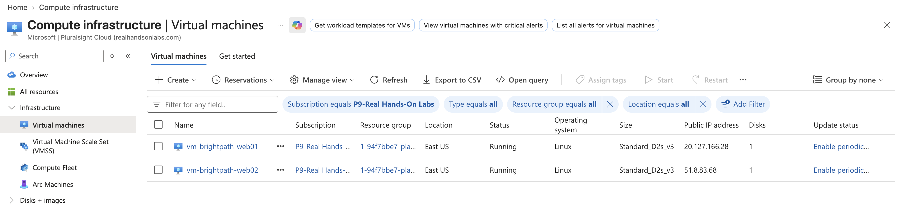

# Project 10 - Azure Load Balancing and High Availability

## Project Overview

This project demonstrates how Azure Load Balancer can be used to distribute incoming web traffic across multiple Azure Virtual Machines and maintain application availability when a backend server becomes unavailable.

The project was designed around BrightPath Solutions, which required its web application to remain accessible even if one of its web servers experienced an outage.

Two Ubuntu web servers were deployed across separate Azure Availability Zones, configured with Nginx, and placed behind a public Azure Load Balancer.

---

## Scenario

BrightPath Solutions hosts a business web application that must remain accessible to users.

Previously, the application depended on a single web server, creating a single point of failure.

The infrastructure team required the solution to:

- Distribute incoming HTTP traffic across multiple web servers
- Reduce dependency on a single virtual machine
- Use separate Availability Zones for improved resilience
- Monitor backend server availability using health probes
- Stop directing new connections to unhealthy backend servers
- Maintain access to the application when one server becomes unavailable

An Azure Standard Load Balancer was implemented to meet these requirements.

---

## Objectives

- Deploy two Azure Virtual Machines in separate Availability Zones
- Configure an Azure Virtual Network
- Install and configure Nginx on both virtual machines
- Create individual web pages to identify each backend server
- Deploy an Azure Standard Public Load Balancer
- Configure a public frontend IP address
- Configure a backend pool containing both virtual machines
- Create an HTTP health probe
- Configure a TCP port 80 load-balancing rule
- Test application connectivity through the Load Balancer
- Simulate a backend server failure
- Verify application availability after failover

---

## Technologies Used

- Microsoft Azure
- Azure Virtual Machines
- Azure Availability Zones
- Azure Virtual Network
- Azure Subnets
- Azure Network Security Groups
- Azure Standard Load Balancer
- Azure Public IP Addresses
- Azure Load Balancer Backend Pools
- Azure Health Probes
- Ubuntu Server 24.04 LTS
- Nginx Web Server
- SSH
- Linux Command Line
- HTTP
- TCP/IP

---

## Implementation

### 1. High Availability Virtual Machine Architecture

Two Ubuntu Server virtual machines were deployed in the East US Azure region.

**Virtual Machines:**

- `vm-brightpath-web01` — Availability Zone 1
- `vm-brightpath-web02` — Availability Zone 2

Both virtual machines were configured using Ubuntu Server 24.04 LTS and the Standard_D2s_v3 virtual machine size.

**Virtual Network:**

`vnet-brightpath-lb`

Deploying the virtual machines across separate Availability Zones helps reduce the risk of both servers becoming unavailable during a single-zone infrastructure failure.

The screenshot below shows the two BrightPath virtual machines deployed in Azure.

---

### 2. Web Server Configuration

Nginx was installed on both Ubuntu virtual machines to provide a simple HTTP web service.

Each server was configured with a unique web page to identify which backend virtual machine was responding to requests.

**Web01:**

`BrightPath Web01`

**Web02:**

`BrightPath Web02`

Both servers were tested using their individual public IP addresses to verify that Nginx was responding over HTTP port 80.

This provided a working application environment before introducing the Azure Load Balancer.

---

### 3. Azure Standard Load Balancer

A public Azure Standard Load Balancer was deployed to distribute incoming HTTP connections across the two backend virtual machines.

**Load Balancer Name:**

`lb-brightpath-web`

**Configuration:**

- SKU: Standard
- Type: Public
- Tier: Regional
- Region: East US

The Load Balancer provides a single frontend address through which users can access the BrightPath web application without connecting directly to an individual backend server.

---

### 4. Frontend IP Configuration

A public frontend IP configuration was created for the Azure Load Balancer.

**Public Frontend IP Address:**

`20.119.111.212`

This address was used as the entry point for HTTP traffic during the sandbox lab.

Users connecting to the frontend IP were directed to a healthy backend virtual machine according to the configured load-balancing rule.

---

### 5. Backend Pool Configuration

A backend pool was created:

`bp-brightpath-web`

The backend pool contained:

- `vm-brightpath-web01`
- `vm-brightpath-web02`

Both virtual machines were registered as backend resources.

The Load Balancer uses this backend pool to determine which servers are eligible to receive incoming network connections.

---

### 6. Health Probe Configuration

An HTTP health probe was configured to monitor the availability of the backend web servers.

**Health Probe Name:**

`hp-http-80`

**Configuration:**

- Protocol: HTTP
- Port: 80
- Request path: `/`

The health probe checks whether the backend servers respond successfully to HTTP requests.

If a server becomes unhealthy, the Load Balancer stops selecting that server for new connections after the health probe detects the failure.

This is an important part of maintaining application availability during a backend outage.

---

### 7. Load-Balancing Rule

A load-balancing rule was configured:

`rule-http-80`

**Configuration:**

- Protocol: TCP
- Frontend port: 80
- Backend port: 80
- Backend pool: `bp-brightpath-web`
- Health probe: `hp-http-80`

The rule forwards incoming HTTP connections from the public frontend IP to healthy backend virtual machines.

Azure Load Balancer operates at Layer 4 of the OSI model, using network connection information rather than inspecting HTTP application content.

---

### 8. Load Balancer Connectivity Testing

The Load Balancer was tested by entering its public frontend IP address into a web browser.

**Test Address:**

`http://20.119.111.212`

The browser successfully displayed:

`BrightPath Web02`

This confirmed that incoming HTTP traffic was reaching the public Load Balancer and being forwarded to a backend web server.

The screenshot below demonstrates successful connectivity through the Azure Load Balancer.

---

### 9. High Availability and Failover Testing

A failover test was performed to simulate a backend server outage.

The test involved stopping `vm-brightpath-web02`, which had previously been serving the web page through the Load Balancer.

The Load Balancer health probe detected that the backend was no longer available.

After the unhealthy backend was removed from active traffic distribution, the application remained accessible through the remaining healthy virtual machine.

The browser displayed:

`BrightPath Web01`

This demonstrated that the Azure Load Balancer could continue serving the application through another healthy backend when one server became unavailable.

The screenshot below demonstrates the application remaining accessible following the simulated backend failure.

---

## Azure Load Balancer vs Application Gateway

Azure Load Balancer operates at Layer 4 and distributes TCP or UDP connections across backend resources.

Azure Application Gateway operates at Layer 7 and supports HTTP/HTTPS-specific capabilities such as URL path-based routing, hostname-based routing and Web Application Firewall integration.

For BrightPath, Azure Load Balancer was selected because the requirement was to distribute HTTP connections across multiple web servers without requiring Layer 7 routing features.

---

## Troubleshooting and Validation

The high-availability solution was validated using the following evidence:

- Both Azure Virtual Machines were deployed successfully
- The virtual machines were configured in separate Availability Zones
- Nginx was installed and configured on both servers
- Individual web server connectivity was tested
- Both virtual machines were added to the Load Balancer backend pool
- An HTTP health probe was configured on port 80
- A TCP load-balancing rule was configured for port 80
- The public frontend IP successfully displayed a BrightPath web page
- A backend virtual machine was deliberately stopped
- The application remained accessible through the remaining backend server

The testing reinforced the importance of backend health monitoring and redundant infrastructure when designing highly available applications.

---

## Key Learning Outcomes

- Understood how Azure Load Balancer distributes incoming network connections
- Deployed virtual machines across separate Availability Zones
- Configured Linux web servers using Nginx
- Understood the purpose of frontend IP configurations
- Configured a backend pool containing multiple virtual machines
- Understood how health probes identify unhealthy backend servers
- Configured a Layer 4 load-balancing rule
- Verified application access through a public Load Balancer
- Simulated a virtual machine failure
- Validated application availability during a backend outage
- Reinforced the difference between high availability and a single point of failure
- Understood when to use Azure Load Balancer instead of Application Gateway

---

## Skills Demonstrated

- Azure Virtual Machine Deployment
- Azure Availability Zones
- Azure Virtual Networking
- Azure Load Balancer Configuration
- Backend Pool Management
- Health Probe Configuration
- TCP/IP Networking
- HTTP Connectivity Testing
- Linux Server Administration
- Nginx Web Server Configuration
- SSH Administration
- High Availability Design
- Failover Testing
- Azure Infrastructure Troubleshooting

---

## AZ-104 Alignment

This project supports skills relevant to the Microsoft AZ-104 Azure Administrator certification, including:

- Deploying and managing Azure Virtual Machines
- Configuring Azure Availability Zones
- Implementing high-availability infrastructure
- Configuring Azure Virtual Networks
- Managing Azure Load Balancers
- Configuring frontend IP addresses and backend pools
- Creating and managing health probes
- Configuring load-balancing rules
- Troubleshooting application connectivity
- Monitoring backend resource health
- Understanding Layer 4 and Layer 7 load-balancing services
- Implementing resilient Azure compute solutions
